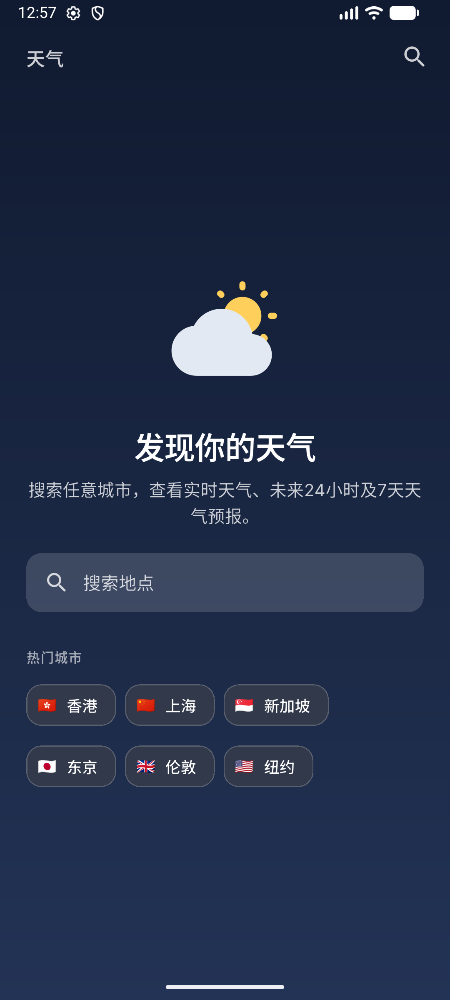
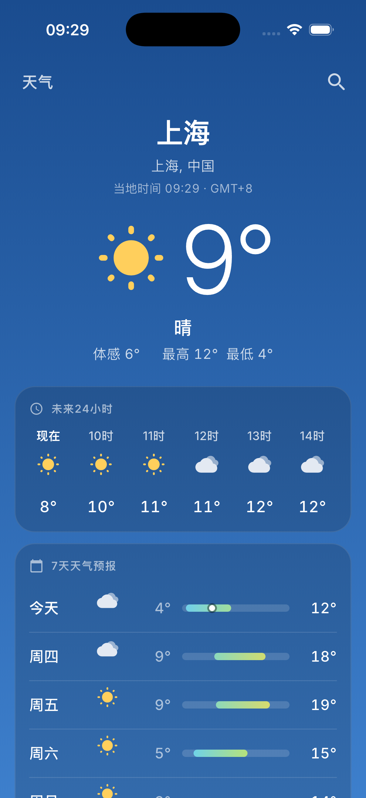
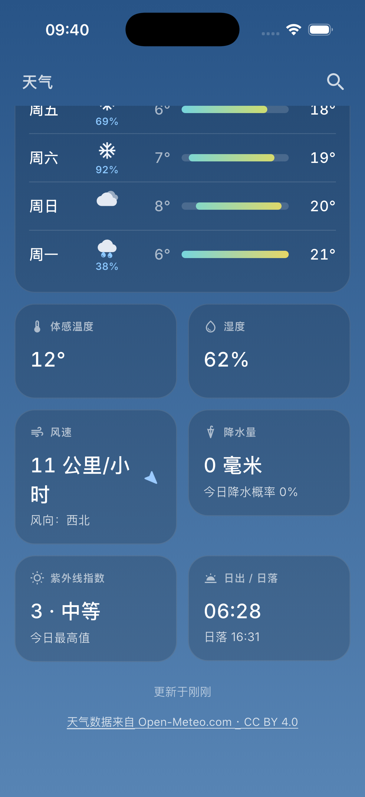
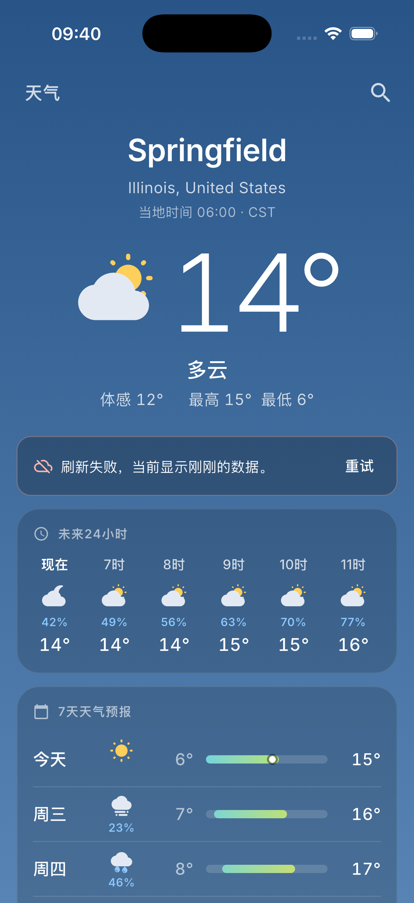
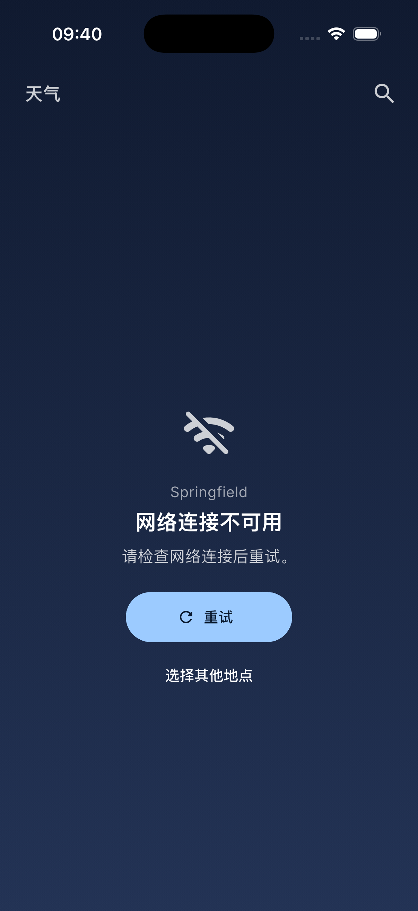

# 天气应用 — Flutter 作业

## 版本与作业范围

本提交为 bf50efa 源码基础上的本地简体中文修改版本，非新的 Git 提交。默认简体中文，不提供中英切换设置。服务未提供译名的地点保持原名。  
实现地点搜索及同名消歧、当前天气、未来24小时与7天预报、加载/空态/错误/离线重试。小时卡片标题保留16dp左留白。

## 实际运行效果

| 空状态 | 搜索消歧 | 当前天气 | 细节 | 刷新失败保留旧数据 | 离线冷启动 |
| --- | --- | --- | --- | --- | --- |
|  |  |  |  |  |  |

> 与原版相同，按六列顺序展示核心状态，另附iOS首页；图片均为中文版本实际运行截图，未修改画面文字。平台与数据来源不同，不作混同：
> - **空状态**：Android 16模拟器上的中文debug应用，2026-11-25 00:58（北京时间，Asia/Shanghai）。
> - **当前天气**：iPhone 17 / iOS 26.0.1模拟器，09:29实际请求官方Open-Meteo并加载上海天气，当时约9°、晴，可见小时标题左留白与部分7天预报。由隔离集成测试驱动，非Fake数据，图中天气不代表当前实时数据。
> - **搜索消歧、细节**：同一iOS模拟器，09:39–09:40的测试数据演示。搜索使用中文同名地点样例；详情已实际向下滚动，展示完整六项细节及底部署名。地点可能保留原文，样例时钟固定为2026-11-24，温度不作实况声明。
> - **刷新失败保留旧数据、离线冷启动**：同一iOS模拟器，09:40的确定性故障注入演示。通过测试服务返回网络错误，分别展示有旧天气时的错误横幅、无天气快照时的整页错误与重试入口；没有修改设备网络，也不是声称现场真实断网。
>
> iOS普通首页见 [docs/screenshots/ios-chinese-home.png](docs/screenshots/ios-chinese-home.png)，采集于09:25，入口为普通`lib/main.dart`。以上日期均为2026-11-25北京时间；均非真机，也不代表全平台/完整人工交互验收。采图专用测试未纳入提交包，应用实现与依赖未为截图修改。

## 环境与运行

Flutter **3.41.0 stable** / Dart **3.11.0**；依赖精确版本见 pubspec.lock。无需API Key。  
解压后进入 weather_app 源码目录：

```bash
flutter --version
flutter pub get --enforce-lockfile
flutter devices
flutter run -d <device-id>
```

Android需已配置Android SDK与兼容JDK；iOS需macOS、Xcode、已安装的iOS模拟器runtime。iOS插件采用项目级Swift Package Manager，不依赖全局flutter config或CocoaPods。真机另需平台签名配置，本作业未验证。

```bash
dart format --output=none --set-exit-if-changed .
flutter analyze
flutter test
flutter build ios --simulator --debug
flutter test integration_test/app_flow_test.dart -d <ios-simulator-id>
flutter test integration_test/live_api_test.dart -d <ios-simulator-id>
```

真实接口测试需要联网。默认pub.dev下载；不要求修改全局镜像/代理。若使用镜像，需保留所有依赖版本和原sha256；锁中来源URL不同会被enforce-lockfile拒绝，不应直接关闭校验。本提交不附机器专用镜像工具或缓存。

## 技术设计与代码组织

### 架构、状态管理与单向数据流

本方案采用 **MVVM风格分层**，而非严格完整版Clean Architecture：`SearchScreen`/`WeatherScreen`是View，`LocationSearchController`/`WeatherController`承担ViewModel职责，`Location`/`Forecast`与服务接口表达领域数据和能力。没有独立UseCase层，天气Controller直接依赖具体`WeatherRepository`，以减少小规模工程的空壳层；代价是仍存在这处具体类型耦合。

事件从View进入Controller，Controller创建新的`SearchState`/`WeatherState`快照，再显式`notifyListeners()`，页面通过`ListenableBuilder`订阅重建。这是声明式UI与观察者通知，不是Rx流或自动双向绑定。状态字段为final，但List没有统一深度冻结，不能当作完全深不可变对象图。`WeatherState`允许“旧数据+刷新中/错误”共存，不强行限定加载/成功/失败三选一。

`AppDependencies.production()`是组合根，选择具体服务、仓库和存储；`AppScope`负责向Widget树注入依赖，不替代Controller的状态订阅。搜索Controller随页面销毁，取消防抖Timer并忽略晚到结果；天气Controller由根组件持有并销毁。

### 组件设计

- `lib/ui/common_widgets.dart`的`GlassCard`只提供卡片外观、标题/图标及内容容器，输入为`title`、`icon`、`child`、`padding`和`titlePadding`，不发业务请求。
- `HourlyForecastCard(hours)`接收小时数据，负责时刻、温度、天气图标与降水概率的横向展示；`DailyForecastCard(days, localToday, currentTemperature)`接收逐日数据和当地今天，负责日期、高低温及整周统一刻度温度条。二者复用容器，而不强行合并成包含大量分支的万能天气组件。
- `GlassCard.titlePadding`默认zero，避免影响其他卡片。小时卡片原本左右内容padding为0以支持贴边横滑，只给其标题行增加左16dp，使图标和标题对齐其他卡片；不对整卡加左padding，避免连小时列一起移动。图标与标题间8dp、小时横滑内容左右8dp inset保持不变。展示组件不承担HTTP、缓存或页面请求生命周期。

### API整合、组织与错误处理

```text
lib/app/                  根组件、组合根、主题、集中中文文案与组件本地化
lib/domain/               地点/天气模型、WMO语义、服务接口和时间规则
lib/data/                 Open-Meteo HTTP/解析、天气仓库、地点持久化
lib/features/search/      搜索Controller、状态与页面
lib/features/weather/     天气Controller、状态、页面及展示组件
lib/ui/                   通用容器、图标、骨架屏和格式化
test/                     单元、Controller、widget与golden测试
integration_test/         Fake流程及真实接口冒烟
```

地理编码通过`GeocodingService`搜索地点，天气通过`WeatherService`获取预报；Open-Meteo实现负责组装请求、HTTP访问和防御式解析。UI不直接访问HTTP。更换数据源时可替换服务实现并在组合根装配，仍需检查字段语义、单位、时间及错误映射的兼容性，不意味着换一个类名就完成适配。

数据层将网络、服务和格式等失败映射为应用错误，界面转为中文信息。没有成功天气快照时显示整页错误及重试；已有天气刷新失败时保留内容、显示错误横幅并允许重试。缺失的可选数值使用占位，而非伪造天气值；加载、空结果和请求失败分别表达。

### 可维护性与测试边界

服务和存储可注入Fake，Controller与页面测试不必依赖真实天气服务；真实API冒烟另行验证外部连通性。UI时钟可注入，避免测试依赖实际时刻。开发保持分层、竞态防护和数据源署名，依赖升级需审查锁文件及测试影响。中文集中在S文案、天气语义和格式化层，保留适量中文注释，不为本次语言变更升级依赖。

## 范围控制与关键取舍

核心投入是地点搜索、当前天气、预报与加载/错误流程的质量及可测试性。没有扩展账号、自建后端或设备权限定位等题外功能，地点由搜索或热门城市选择。当前固定简体中文，不自动中英切换；系统组件中文委托仅覆盖本App使用范围，不当作完整通用国际化框架。以下是当前方案的理由与边界，并非声称候选人曾独立完成所有初始决策。

| 问题             | 当前选择及未选方案                                                                              | 接受的代价／何时重评                                                               |
| -------------- | -------------------------------------------------------------------------------------- | ------------------------------------------------------------------------ |
| 两个核心页面如何管理状态   | ChangeNotifier + 状态快照 + ListenableBuilder；暂不引入Bloc/Riverpod或完整UseCase层，避免小作业的额外学习与装配成本 | 手动维护通知、生命周期及异步竞态，Controller仍依赖具体Repository；跨模块状态和业务组合明显增加时再评估拆层及状态框架     |
| 连续输入及乱序响应      | 350ms防抖减少请求；generation丢弃过期结果。键盘提交可跳过等待，不以只做防抖代替正确性保护                                   | 增加少量输入等待；丢弃结果不是真正取消HTTP，在途请求仍耗流量。请求昂贵或高频时再考虑可取消客户端                       |
| 请求量、速度与天气新鲜度   | 10分钟内存TTL、最多12条按最近写入顺序淘汰、同地点并发复用Future；不做持久化天气缓存。刷新失败保留旧数据和错误提示                        | 不是标准LRU；缓存命中不提升淘汰优先级。存在时效延迟，进程结束后离线冷启动无天气快照；若要求严格实时或持久离线，应重设策略并清楚标示旧数据时间 |
| 地点时间与设备时区不同    | 请求timezone=auto，将当地墙上时间借UTC容器保存，按接口偏移换算当地此刻；不引入完整时区规则引擎                                | 维护者不可误用toLocal；依赖返回偏移，不覆盖完整跨夏令时规则。复杂历史/预约等跨时区业务应采用明确的时区模型                |
| 可复现的数据接入与上线可靠性 | Open-Meteo免Key，适合评估运行；通过服务接口隔离而非自建天气后端。中文采用集中S与轻量委托而非整套多语言设置                           | 外部接口可能不可用且免费服务有使用限制；无生产SLA保证。商业上线需重新核对条款与服务保障；增加语言时应转向完整l10n并补齐系统组件覆盖    |

## 最新中文版本实际验证（Asia/Shanghai）

- Mac Flutter3.41.0/Dart3.11.0：format/analyze通过；宿主测试78通过、6项Linux golden跳过。
- Xcode26.0.1、iPhone17 / iOS26.0.1模拟器：debug构建、2项fake集成与1项真实接口冒烟通过；普通main中文首页启动确认。
- Android：本机使用既有SDK/JDK离线arm64 debug构建成功；Android模拟器安装启动、中文首页确认。本轮未跑Android中文集成测试。
- 未验证：中文golden、中文release构建、iOS/Android真机、完整人工逐页UI/无障碍走查；不得据此宣称双端全部验收。
- `test/goldens/`所附图片为历史英文Linux基准，保留用于追溯。在Mac按设计跳过；在Linux对中文版本运行可能因文案变化失败，需审阅生成中文基准，不能把旧基准当中文截图证据。
- 包内源码/lib、test、integration_test、平台工程、pubspec与lock来自实际已验证本地中文目录。未重跑测试仅为生成本提交包，打包没有修改实现。

后续优先补齐中文Linux截图基准及Android中文集成回归，再验证真机、release及完整人工交互/无障碍；本次仅补充文档，未执行这些改进，也未重跑上述测试。

## 数据源与版权

天气数据：[Open-Meteo](https://open-meteo.com/)，CC BY 4.0；地理编码源GeoNames，CC BY 4.0。保留App内可点击署名；免费接口限非商业用途，使用前核对服务当前条款。随包Inter字体及OFL许可见 assets/fonts/Inter-OFL.txt。

## AI使用

源码、测试与文档由AI协助生成、审查和验证；候选人提供需求及修改方向，不应描述为全部手工编写。先前云端实现后迁移Flutter3.41；本版本直接在Mac现有工程完成中文化与上述验证。候选人仍应阅读代码并独立解释架构、竞态和错误处理。未声称候选人已完成全量人工代码审查。
